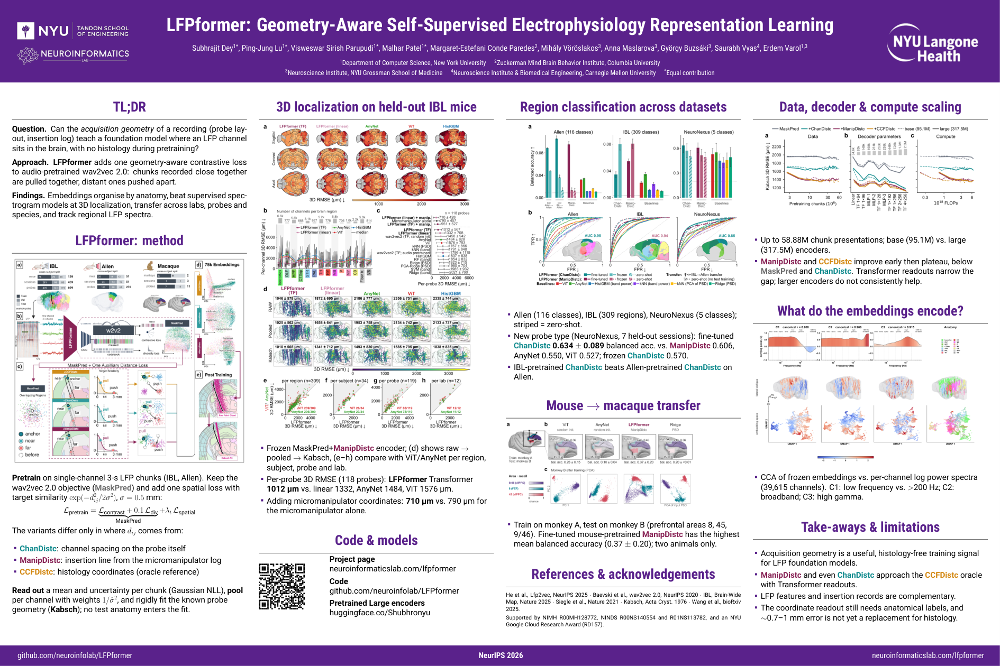

# LFPformer — NeurIPS 2026 poster

Poster for **LFPformer: Geometry-Aware Self-Supervised Electrophysiology Representation Learning**
(NeurIPS 2026).



- `poster.tex`: poster source (120 × 80 cm landscape, 4 columns)
- `poster.pdf`: compiled poster
- `figures/`: figures cropped from the camera-ready paper (see `figures/README.md`)
- `logos/`, `fonts/Roboto/`: logos and the bundled Roboto font (OFL)

## Build

```bash
make            # uses tectonic (conda install -c conda-forge tectonic)
# or, with a full TeX Live install:
latexmk -lualatex poster.tex
```

Fonts are loaded from `fonts/Roboto/static/`, so no system fonts are needed.

## Links

- Project page: https://www.neuroinformaticslab.com/lfpformer
- Code: https://github.com/neuroinfolab/LFPformer
- Pretrained Large encoders: https://huggingface.co/Shubhronyu

## Credits

The layout uses the [Gemini](https://github.com/anishathalye/gemini) beamerposter theme
(MIT, see `LICENSE.md`) with the NYU colour theme from the Lfp2vec NeurIPS 2025 poster.
